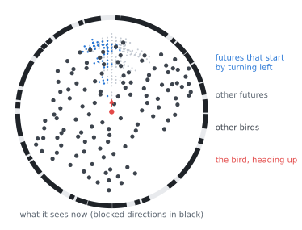
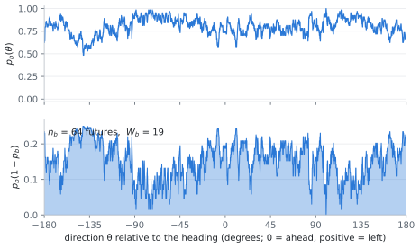
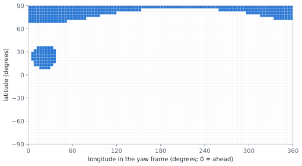

# Notes: the model, the score, empowerment, 3D, results

These notes explain what the simulators compute and why. §1 states the model. §2 derives, line by line, the
formula the code uses for the score of a move. §3 shows that this score is the high-noise limit of *visual
empowerment*, and spells out every assumption behind that statement. §4 extends the model to 3D. §5 summarises the
results of the 2026 runs. How the code computes all this quickly is in [OPTIMIZATIONS.md](OPTIMIZATIONS.md).

Notation: $N$ agents, lookahead $\tau$ steps, $M$ moves per step ($M = 5$ in 2D, 7 in 3D). An angle $\theta$ is a
direction in an agent's field of view, measured from its heading.

## 1. The model

Agents are discs of radius $R = 1$ in the plane, each with a position, a heading and a speed. Time is discrete
($dt = 1$). At every step each agent chooses one of five moves:

| move | 0 | 1 | 2 | 3 | 4 |
|---|---|---|---|---|---|
| heading change | $-\Delta\theta$ | $+\Delta\theta$ | 0 | 0 | 0 |
| speed | $v_0$ | $v_0$ | $v_0 - \Delta v$ | $v_0$ | $v_0 + \Delta v$ |

with $\Delta\theta = 15°$, $v_0 = 10$, $\Delta v = 2$. The agent decides by imagining the future:

1. **Futures.** It considers every sequence of $\tau$ moves ($5^\tau$ of them), and the positions it would pass
   through. Each position reached after $k$ moves is a *future* at level $k$.
2. **The others.** It assumes every other agent flies straight on at speed $v_0$ ("ballistic" prediction).
3. **Collisions.** A future in which it overlaps another agent (at the end of a step, or by passing through it
   during the step) is discarded, together with everything after it.
4. **Visual state.** For every surviving future $u$ it computes what it would see: the set of directions, relative
   to its heading at $u$, that are covered by the other agents' discs. Write this as a function
   $f_u(\theta) \in \{0, 1\}$: 1 if direction $\theta$ is blocked by a disc, 0 if it is free. A disc at distance
   $d$ covers an interval of half-width $\arctan(R/d)$ around its direction (the paper's choice; the code also offers
   the geometrically exact $\arcsin(R/d)$).
5. **Score.** The futures are grouped by their first move $b$. Each first move gets a score $W_b$ (§2) that
   measures how *varied* its surviving futures' visual states are.
6. **Decision.** The agent takes the move with the highest score (ties broken at random).

All agents decide from the same snapshot, then all move at once.

*One bird (red) in a flock at $\tau = 4$, drawn in its own frame. Dark dots: the other birds. Light dots: the positions
of its surviving futures; blue: those that start by turning left. The ring shows what the bird sees now: the black arcs are the directions blocked by other birds.*

In the discrete version of the paper the field of view is cut into 40 sensors and the score of a move is the
number of *distinct* sensor readings among its futures: how many non-degenerate futures it keeps open. The
continuous version, used here, keeps the exact field of view and needs a continuous measure of how different two
futures look. That is §2.

## 2. The score of a move

### 2.1 Definition

Take one first move $b$ and the set $F_b$ of its surviving futures, all levels $1..\tau$ pooled. Different move
sequences can lead to the same future; each sequence counts once, so $F_b$ is a list with repeats, of length
$n_b$ = the number of surviving move sequences that start with $b$.

The distance between two futures $i$ and $j$ is the fraction of the field of view in which they differ:

$$d_{ij} = \frac{1}{2\pi} \int_0^{2\pi} \big|f_i(\theta) - f_j(\theta)\big|\, d\theta .$$

$d_{ij} = 0$ when the two views are identical, 1 when each direction blocked in one is free in the other. The score
of the paper (SI eqs. 1–2) is the average, over the futures, of their summed distance to all the others:

$$W_b = \frac{1}{n_b} \sum_{i \in F_b} \sum_{j \in F_b} d_{ij} .$$

Computed like this, $W_b$ costs $n_b^2$ comparisons of two views. At $\tau = 6$, $n_b$ is up to
$1 + 5 + \dots + 5^5 = 3906$, i.e. 15 million pairs per move per agent per step. The rest of this section rewrites
$W_b$ so that it costs about $n_b$ operations instead.

### 2.2 From pairs to a sum over directions

**Step 1: the absolute difference of two bits.** For $a, c \in \{0, 1\}$,

$$|a - c| = a + c - 2ac .$$

(Check the four cases: $|0-0| = 0$, $|1-0| = 1$, $|0-1| = 1$, $|1-1| = 0 = 1 + 1 - 2$.)

**Step 2: sum over all pairs, one direction at a time.** Fix a direction $\theta$ and let

$$S_b(\theta) = \sum_{i \in F_b} f_i(\theta)$$

be the number of futures of $b$ in which direction $\theta$ is blocked. Summing step 1 over all $i, j$:

$$\sum_{i}\sum_{j} \big|f_i(\theta) - f_j(\theta)\big|
= \sum_{i}\sum_{j} f_i(\theta) + \sum_{i}\sum_{j} f_j(\theta) - 2 \sum_i f_i(\theta) \sum_j f_j(\theta)
= n_b S_b + n_b S_b - 2 S_b^2 = 2\, S_b(\theta)\,\big(n_b - S_b(\theta)\big).$$

(The first double sum is $n_b$ copies of $\sum_i f_i = S_b$; so is the second; the third factorises.)

**Step 3: integrate over directions.** Swapping the sum and the integral in the definition of $W_b$:

$$W_b = \frac{1}{n_b}\,\frac{1}{2\pi}\int_0^{2\pi} \sum_i\sum_j |f_i - f_j|\, d\theta
= \frac{1}{\pi\, n_b}\int_0^{2\pi} S_b(\theta)\,\big(n_b - S_b(\theta)\big)\, d\theta .$$

This is the formula the code uses. $S_b(\theta)$ is built from one pass over the futures, and it only changes value
at the ends of the blocked intervals, so the integral is a sum over those endpoints.

### 2.3 What it measures

Let $p_b(\theta) = S_b(\theta)/n_b$, the fraction of $b$'s futures in which direction $\theta$ is blocked. Then

$$W_b = \frac{n_b}{\pi} \int_0^{2\pi} p_b(\theta)\,\big(1 - p_b(\theta)\big)\, d\theta .$$

$p(1-p)$ is the variance of a coin that comes up "blocked" with probability $p$. It is zero where all the futures
agree (the direction is always free, or always blocked) and largest, $1/4$, where they disagree half the time. So

> **$W_b$ = (number of surviving futures) × (how much, summed over the field of view, those futures disagree
> about what is visible).**

A move scores well if it keeps many futures alive *and* those futures look different from each other. Identical
futures add to $n_b$ but not to the disagreement; this is the continuous version of the discrete model's count of
distinct visual states.

*The same bird. Top: $p_b(\theta)$ for its move "turn left", the fraction of that move's futures in which each
direction is blocked. Bottom: $p_b(1-p_b)$; the shaded area times $n_b/\pi$ is $W_b$.*

## 3. The score is the high-noise limit of visual empowerment

*Empowerment* is the information an agent's actions can inject into its own future sensor readings: the capacity
of the channel from actions to future perceptions (Klyubin, Polani & Nehaniv 2005). FSM can be read as a cheap
stand-in for it. This section makes that precise: with the assumptions below, $W_b$ is exactly the leading term of
the empowerment of move $b$ when perception is very noisy.

### 3.1 Assumptions, and what they mean physically

| | assumption | physically |
|---|---|---|
| A1 | The others fly straight on (the model's own prediction). | The agent's world model; not specific to this section. |
| A2 | The agent's plan $A$ is a surviving move sequence starting with $b$, chosen uniformly at random. | The agent treats all its viable plans as equally likely. (Empowerment proper would use the input distribution that maximises the information, §3.5.) |
| A3 | The perception $Y$ is the view at a random future time: level $k$ with probability proportional to the number of level-$k$ sequences. | The futures of all levels are pooled, as in $W_b$. |
| A4 | Futures that end in a collision carry no information; the information of move $b$ is weighted by its survival fraction $n_b/n_{\max}$, where $n_{\max} = \sum_{k=1}^{\tau} M^{k-1}$ is $n_b$ without collisions. | Dying is not a way of being informative. (Counting "dead" as one more outcome would *reward* a 50% risk of death.) |
| A5 | The agent sees its future view through **white Gaussian noise**: every independent pattern of the view (every orthonormal mode, §3.2) is corrupted by independent noise of the same variance $\sigma^2$. | Perception is imperfect, equally so for every feature of the view. |
| A6 | **High noise**: $\sigma^2$ is large compared with the squared distance between two futures' views. | Any single future is barely distinguishable from the others; the agent can only perceive what its futures look like on average, and how much they spread. |

Why noise at all? Without it, two different futures of a continuous visual field are always perfectly
distinguishable (on real flocks two futures of the same move differ in ~30% of their field of view). The
information is then $\log n_b$: empowerment only counts surviving futures, and what they look like no longer
matters. A1–A5 define the noisy version, $\mathfrak{E}_\sigma(b)$; A6 is the regime in which it reduces to $W_b$.

### 3.2 Views as vectors

To add noise to a view we need coordinates for it. The functions on the circle have the inner product

$$\langle f, g \rangle = \frac{1}{2\pi} \int_0^{2\pi} f(\theta)\, g(\theta)\, d\theta ,$$

and an orthonormal basis, for example $\{1, \sqrt{2}\cos k\theta, \sqrt{2}\sin k\theta : k = 1, 2, \dots\}$. The
coordinates $x_u = (\langle f_u, e_1\rangle, \langle f_u, e_2 \rangle, \dots)$ of view $u$ in this basis have two
properties we need:

- **Distances are preserved** (Parseval): $\|x_i - x_j\|^2 = \langle f_i - f_j, f_i - f_j \rangle
  = \frac{1}{2\pi}\int (f_i - f_j)^2\, d\theta$. For views that take the values 0 and 1, $(f_i - f_j)^2 = |f_i - f_j|$,
  so $\|x_i - x_j\|^2 = d_{ij}$: **the squared distance between two views is the fraction of the field in which
  they differ.**
- **White noise does not depend on the basis**: independent $\mathcal N(0, \sigma^2)$ noise on each coordinate of one
  orthonormal basis is independent $\mathcal N(0, \sigma^2)$ noise on each coordinate of any other.

The channel of A2–A5 is then

$$Y = x_A + \sigma Z, \qquad Z \sim \mathcal N(0, I),$$

and $\mathfrak E_\sigma(b) = \frac{n_b}{n_{\max}}\, I(A; Y)$. (Only the finitely many directions spanned by the
$n_b$ futures matter: the noise in the others is independent of $A$ and carries no information.)

### 3.3 Information through a noisy channel at high noise

Let $C = \mathrm{Cov}(x_A)$ be the covariance of the futures' coordinates under A2, and $\mathrm{tr}\,C$ its
trace, the total variance. The result we need is

$$I(A; x_A + \sigma Z) = \frac{\mathrm{tr}\,C}{2\sigma^2} + O(\sigma^{-4}) \qquad (\sigma \to \infty).$$

*Why.* Write $s = 1/\sigma^2$ (the signal-to-noise ratio) and $I(s) = I(A;\, \sqrt{s}\, x_A + Z)$, which is the same
information (dividing $Y$ by $\sigma$ loses nothing). The I-MMSE relation of Guo, Shamai & Verdú (2005) states
that for any input distribution

$$\frac{dI}{ds} = \frac{1}{2}\, \mathrm{mmse}(s),$$

where $\mathrm{mmse}(s)$ is the mean squared error of the best estimate of $x_A$ from the output. At $s = 0$ the
output says nothing, the best estimate is the mean, and the error is the total variance: $\mathrm{mmse}(0) =
\mathrm{tr}\,C$. With $I(0) = 0$, a first-order expansion gives $I(s) = \frac{s}{2}\,\mathrm{tr}\,C + O(s^2)$.

*Sanity check.* For a Gaussian input the information is known exactly,
$I = \frac12 \log\det(I + C/\sigma^2) = \frac12 \sum_m \log(1 + c_m/\sigma^2)$ over the eigenvalues $c_m$ of $C$, and
$\log(1 + c/\sigma^2) \approx c/\sigma^2$ gives the same leading term. At high noise, the information depends on the
futures only through their total variance, not on how they are arranged.

### 3.4 Putting it together

**Total variance = disagreement.** By Parseval (§3.2) the total variance of the coordinates is the variance of the
view, integrated over directions:

$$\mathrm{tr}\, C = \frac{1}{2\pi}\int_0^{2\pi} \mathrm{Var}_A\big(f_A(\theta)\big)\, d\theta
= \frac{1}{2\pi}\int_0^{2\pi} p_b(\theta)\big(1 - p_b(\theta)\big)\, d\theta ,$$

since under A2 $f_A(\theta)$ is a coin that is 1 with probability $p_b(\theta)$. Comparing with §2.3:

$$W_b = \frac{n_b}{\pi}\int p_b (1 - p_b)\, d\theta = 2\, n_b\, \mathrm{tr}\, C_b .$$

**The empowerment of move $b$.** From §3.3 and A4,

$$\mathfrak{E}_\sigma(b) = \frac{n_b}{n_{\max}} \left(\frac{\mathrm{tr}\, C_b}{2\sigma^2} + O(\sigma^{-4})\right)
= \boxed{\;\frac{W_b}{4\, n_{\max}\, \sigma^2} + O(\sigma^{-4})\;}$$

The factor $1/(4\, n_{\max}\, \sigma^2)$ is the same for every move. So at high noise, **maximising $W_b$ and
maximising visual empowerment choose the same move**. The two factors of $W_b$ have a meaning here: $n_b$ is the
survival weight (A4), and the disagreement $\int p(1-p)$ is the information the noisy view carries about which
surviving future happens.

### 3.5 Beyond the assumptions

- **Lower noise.** As $\sigma$ decreases, the futures become distinguishable and $\mathfrak E_\sigma(b)$ moves from
  the variance regime (proportional to $W_b$) to $\frac{n_b}{n_{\max}}\log n_b$, which only counts survivors. In
  between, how the futures are arranged matters, not just their variance.
- **Capacity instead of a uniform plan (A2).** Maximising the information over the plan distribution gives, at high
  noise, $\max_p \mathrm{tr}\, C_p / 2\sigma^2$, which is attained by putting all the weight on the two most distant
  futures: it measures the *diameter* of the set of futures, not how many different futures there are. The uniform
  choice is what makes the score reward many varied futures.

### 3.6 Numerical check

`scripts/empowerment_check.py` computes $\mathfrak{E}_\sigma(b)$ by Monte Carlo on real flock states (τ = 4, every
one of the $5^4$ move sequences enumerated) and counts how often each score picks the same move, among clear-cut
decisions (best move ahead of the runner-up by more than 2%):

| σ | N = 500: $W_b$ | Gaussian bound | $\log n_b$ | decisions | N = 2500: $W_b$ | Gaussian bound | $\log n_b$ | decisions |
|---|---|---|---|---|---|---|---|---|
| 0.05 | 81% | 87% | **100%** | 69 | 88% | 88% | **96%** | 26 |
| 0.1 | 89% | 92% | 84% | 89 | 98% | 100% | 80% | 41 |
| 0.2 | 98% | 99% | 62% | 107 | 94% | 95% | 57% | 77 |
| 0.3 | 93% | 92% | 62% | 125 | 82% | 82% | 49% | 89 |

(50 agents in each of 4 frames of the τ = 6 runs of §5.1; "Gaussian bound" is
$\frac{n_b}{n_{\max}}\frac12\log\det(I + C_b/\sigma^2)$ with all modes.)

In the regime where the diversity of futures matters (σ ≈ 0.1–0.3: the typical squared distance between futures
is ~0.3), $W_b$ makes 82–98% of empowerment's decisions, about as many as the full Gaussian bound. At σ = 0.05, where
futures are already nearly distinguishable, empowerment has become survival counting ($\log n$).

## 4. The model in 3D

### 4.1 Agents and moves

Agents are spheres of radius $R$. A heading is an azimuth $\theta$ and an elevation $\phi$ (the angle above the
horizontal), in a frame aligned with gravity: agents do not roll. There are 7 moves: yaw by $\pm\Delta\theta$, pitch by
$\pm\Delta\theta$, speed $v_0 \pm \Delta v$ with the heading unchanged, or straight on at $v_0$. A pitch beyond
$\pm\phi_{\max} = 75°$ is not available (it would approach the poles of the heading coordinates); such futures are
discarded like collisions. Elevations stay on the lattice of multiples of $\Delta\theta$ (the initial ones are rounded
to it). The others are predicted straight on, and collisions are swept spheres, as in 2D.

### 4.2 The visual field on the sphere

A view is now a function on the sphere of directions, $f_u(\omega) \in \{0,1\}$, with $\omega$ a unit vector. Another
agent at distance $d$ blocks a *spherical cap*: the directions within angle $\alpha = \arctan(R/d)$ of its centre.
The view is expressed in the future's own **yaw frame**, rotated about the vertical by the future's azimuth, with
elevations kept absolute. (Physically: the agent looks along its horizontal direction of travel and keeps "up" up.)

Everything in §2 carries over with $\frac{1}{2\pi}\int d\theta$ replaced by the average over the sphere,
$\frac{1}{4\pi}\int d\Omega$:

$$d_{ij} = \frac{1}{4\pi}\int_{S^2} |f_i - f_j|\, d\Omega, \qquad
W_b = \frac{1}{n_b}\sum_{i,j} d_{ij} = \frac{1}{2\pi\, n_b}\int_{S^2} S_b(\omega)\,\big(n_b - S_b(\omega)\big)\, d\Omega .$$

The steps are the same: $|a - c| = a + c - 2ac$ for bits, sum over pairs at fixed $\omega$, integrate. So is §3,
with the inner product $\frac{1}{4\pi}\int f g\, d\Omega$ and an orthonormal basis of the sphere (e.g. the spherical
harmonics), so $W_b$ is again the high-noise limit of visual empowerment.

### 4.3 The discretised sphere

The code samples the sphere on a latitude–longitude grid of $n_{\rm lon} \times n_{\rm lat}$ pixels (192 × 96 by
default) and weights each pixel by its solid angle, $\Omega_{\rm pix} = \frac{2\pi}{n_{\rm lon}} (\sin\beta_{\rm top} -
\sin\beta_{\rm bottom})$:

$$W_b \approx \frac{1}{2\pi n_b} \sum_{\rm pixels} \Omega_{\rm pix}\, S_b\, (n_b - S_b).$$

A pixel is blocked when its centre lies inside a cap. On one row of latitude $\beta$, the directions of a cap with
centre at latitude $\beta_c$ and longitude $\lambda_c$ form a single interval of longitudes. By the spherical law of
cosines the angle $\gamma$ between the row's direction at longitude $\lambda$ and the cap's centre obeys
$\cos\gamma = \sin\beta \sin\beta_c + \cos\beta\cos\beta_c\cos(\lambda - \lambda_c)$, so $\gamma \le \alpha$ exactly when

$$\cos(\lambda - \lambda_c) \;\ge\; \frac{\cos\alpha - \sin\beta\,\sin\beta_c}{\cos\beta\,\cos\beta_c} ,$$

an interval $|\lambda - \lambda_c| \le \Delta\lambda$ (or the whole row, or nothing). A cap is painted row by row as
one interval each.

*Two neighbours seen on a 96 × 48 grid (for visibility; the simulations use 192 × 96): each blocked region is one
interval per row, wider towards the pole as the rows shrink.*

Because a view in the yaw frame of azimuth $a\,\Delta\theta$ is the view of azimuth 0 shifted by $a\,\Delta\theta$ in
longitude, $n_{\rm lon}$ is a multiple of $360°/\Delta\theta = 24$: futures at the same place with different
azimuths share one painted view, shifted by whole pixels. On flocked states the 192 × 96 grid makes the same
decisions as a 1536 × 768 one for 100% of 60 checked agents (median score error $4 \times 10^{-4}$).

## 5. Results (2026 runs)

All runs start from random positions (a square or cube) with headings spread by 15° around a common direction.
They can be reproduced with the commands in the README and `scripts/run_matrix.py`.

### 5.1 2D: flocks and their size

Order parameter / share of birds in the largest group, averaged over steps 1000–5000 of the 5000-step runs (random
start in a box of side $250\sqrt{N/500}$, i.e. the paper's density; groups linked at 3 × the median
nearest-neighbour distance; one seed each, so differences of ~0.05 are noise):

| N \ τ | 6 | 7 | 8 | 9 | 10 | median nn distance (τ = 6) |
|---|---|---|---|---|---|---|
| 500 | 0.95 / 97% | 0.96 / 99% | 0.96 / 99% | 0.97 / 99% | 0.97 / 100% | 7.5 |
| 1000 | 0.93 / 99% | 0.93 / 96% | 0.92 / 99% | 0.93 / 99% | 0.94 / 99% | 8.3 |
| 2500 | 0.66 / 77% | 0.74 / 84% | 0.88 / 98% | 0.88 / 99% | 0.88 / 99% | 10.6 |
| 5000 | 0.27 / 54% | 0.23 / 51% | 0.23 / 64% | 0.60 / 84% | 0.50 / 80% | 13.3 |
| 10000 | 0.26 / 55% | 0.21 / 62% | 0.29 / 64% | 0.24 / 74% | 0.30 / 87% | 18.4 |

- **Cohesion falls with N; a longer lookahead helps.** Up to N = 1000 the swarm is one ordered flock at every τ. At
  N = 2500 it is one flock from τ = 8. From N = 5000 it never settles: it spreads, folds and sprouts arms, more
  cohesive at larger τ (largest group 54% at τ = 6, 80–87% at τ = 10) but not ordered. No initial condition we tried
  (discs, bands, wide fronts, pre-formed flocks) keeps a 2D flock above N ≈ 3000 coherent at τ = 6: it is an effect of
  size.
- **Why: opacity.** FSM agents settle where about **two thirds** of their field of view is blocked (0.6–0.73 at
  N = 500–5000). At fixed opacity the
  radius of a 2D flock grows ∝ N (the line of sight through a disc of radius L sees ∝ ρ L agents), so large 2D
  flocks are very dilute (median nearest-neighbour distance 13–14 at N = 5000 against 7.5 at N = 500), and a random
  start at the N = 500 density is far too opaque for them: they first expand violently.
- **N = 50000, τ = 6** (10000 steps, 8 GPUs, 4.9 h): a square → a dense disc with rings → a spiky starburst → a
  large rounded flock covered in streamers, which keeps changing shape slowly.

### 5.2 3D

- Every 3D run of the N × τ matrix (N = 500…10000, τ = 6–8, 2000 steps) forms one coherent flock (order ≈ 0.98)
  within ~500 steps, an ellipsoid flattened along the direction of travel, and stays so. At N = 10000, τ = 6 the median
  nearest-neighbour distance drops from 6.1 to 3.9 and the radius of gyration from 119 to 63.
- 3D flocks settle where about **half** of the sphere of view is blocked. A random cube is nearly transparent (0.21 at N = 10000), so it
  contracts, whereas the 2D square expands. At fixed opacity a 3D flock's radius grows only ∝ √N, so large 3D
  flocks stay dense and coherent.
- Starting shapes do not destabilise it: dense balls, sheets and head-on groups re-form the ellipsoid, or (random
  headings, rotating rings) split into compact sub-flocks that never rejoin.

### 5.3 Predators

A predator is a sphere that flies at the flock (`--predator`): straight, or turning at most 10° per step towards the
flock's centre, the nearest bird, or the point where it can intercept the flock. The agents predict it straight on,
and futures that come within $R + r + g\,k$ of it at lookahead level $k$ die like collisions: $r = 3$ is its
radius, and $g$, the growth per level, stands for the agents' uncertainty about where it will go. It is not part of
their visual fields. With `--pred-vision on`, an agent only knows of a predator if it sees it (outside a 60° blind
cone behind it, with no other agent in the line of sight), and remembers the last sighting for 30 steps.

N = 1000, τ = 6, predators from step 100:

- A small fixed danger zone ($g = 0$) hardly matters: birds dodge locally.
- With a growing zone the flock responds as a whole. From behind with $g = 4$: a coordinated escape (turning jumps
  from 0.6° to ≈ 7.5° per 10 steps, climbing to ≈ 47°). $g = 6$: repeated splits and rejoins. $g = 8$: the flock bursts
  into five groups that never rejoin. The threshold between healing and shattering is sharp.
- **Vision** changes the outcome: with it the predator arrives unseen and the flock bursts outward at the last
  moment (176 caught against 6 when all know). The coordinated escape needs memory (with a 5-step memory the escape
  turn is 1.4° per 10 steps instead of 6.4°).
- At N = 5000 a predator from behind bores a tunnel through the flock: a vacuole of radius ≈ 15–20 around its path,
  invisible from outside (the 3D viewer's Slice button shows it).

**Two predators, and the lookahead.** One predator from behind aiming at the flock's centre, one intercepting from
above ($g = 4$, speed 20). In every run the flock splits in two at step ≈ 112:

| τ | seeds | birds caught | after the split |
|---|---|---|---|
| 6 | 1, 2, 3 | 13, 1, 7 | the halves always rejoin (seed 1: three split–rejoin cycles) |
| 7 | 1, 2, 3 | 5, 1, 0 | the halves never rejoin; they fly side by side and drift ≈ 600 apart |
| 8 | 1 | 0 | never rejoin |

A longer lookahead escapes earlier and more cleanly, and loses fewer birds, but the halves no longer come back
together; both predators, aiming at the swarm's centre, then circle the empty gap between them.

## References

- H. J. Charlesworth, M. S. Turner, *Intrinsically motivated collective motion*, PNAS 116, 15362 (2019).
- A. S. Klyubin, D. Polani, C. L. Nehaniv, *Empowerment: a universal agent-centric measure of control*, IEEE CEC (2005).
- D. Guo, S. Shamai, S. Verdú, *Mutual information and minimum mean-square error in Gaussian channels*, IEEE Trans.
  Inf. Theory 51, 1261 (2005).
