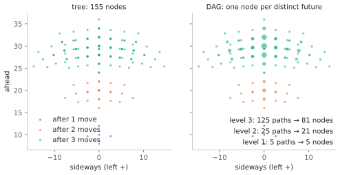

# Optimizations

How the simulators compute FSM decisions fast enough for flocks of 50,000 and lookaheads of τ = 10, when a direct
implementation manages a few hundred birds at τ = 4–5. The model and the score are defined in
[NOTES.md](NOTES.md); every optimization here is exact (it changes no decision) unless it is marked as an
**approximation**, in which case its effect on decisions is measured.

Timings are from a laptop (Intel Core Ultra 9 275HX, 24 cores; NVIDIA RTX 5070 Ti Laptop, 46 SMs) unless stated,
and from a cloud machine with 8 NVIDIA RTX PRO 6000 (188 SMs each) where marked.

## 1. Where the time goes

For every agent, every step, a direct implementation:

1. builds the tree of futures: $n_{\rm tree} = \sum_{k=1}^{\tau} 5^k$ nodes (19,530 at τ = 6);
2. for each node, predicts the other $N - 1$ agents, checks collisions and projects every other agent into the
   node's field of view (sorting $N$ intervals and merging them);
3. scores each first move by comparing all pairs of its futures' views: $\sim (n_{\rm tree}/5)^2$ pairs per move.

That is $\sim N\, n_{\rm tree}\, (N \log N + n_{\rm tree})$ per agent, or $10^{14}$ elementary operations per step at
N = 500, τ = 6. The optimizations below remove, in turn, the $n_{\rm tree}^2$ (§2.3), most of the $n_{\rm tree}$
(§2.2), and the constant factors (§2.4–§5).

| | N = 500, τ = 6, one step (flocked state) |
|---|---|
| exact CPU code, 24 threads | **0.95 s** |
| … on 1 thread | 14.3 s |
| … with the full tree instead of the DAG (§2.2) | 4.4 s |
| … scoring from the pairwise definition, even on the DAG (§2.3) | 99 s |
| GPU (§3), real run | **0.018 s** |

## 2. The exact CPU simulator (`src/fsm2d/cpu_evaluator.hpp`)

### 2.1 Fixes to the original code

The 2019 code (discrete sensors, `main.cpp` on `master`) had bugs that change results, fixed here:

- The collision check returned early: if the agent already overlapped one agent at the start of a step, the other
  agents were never checked.
- The crossing test used the slope of the relative trajectory, which is infinite for vertical motion (NaNs and
  missed collisions). It is replaced by the closest-approach test on the step.
- `acos` of a ratio rounded past ±1 gave NaN, which silently dropped that agent from the view. Angles now come
  from `atan2`.
- Ties between moves were broken in a fixed, biased order (always a turn over going straight). They are now broken
  uniformly at random.
- The half-angle of a disc was `atan(R/d)`, the paper's choice (the exact value is `asin(R/d)`); both are available.
- Runs were not reproducible (the random seed was the clock). All random draws now come from streams indexed by
  (seed, step, agent) (`src/common/rng.hpp`), so a run is bit-identical whatever the number of threads or GPUs,
  and after being interrupted and resumed.

### 2.2 The future-state DAG (`src/fsm2d/dag.hpp`)

Where a future is depends only on *which* headings were flown and at what speeds, not in which order:
turning left then right lands exactly where turning right then left does, with the same heading. A future is
therefore identified by its current heading index and, for every heading, the number of steps flown at it and the
sum of their speed changes. Futures with the same key are the same point with the same heading, and everything
after them is the same too. Merging them turns the tree into a DAG:

| τ | 4 | 5 | 6 | 7 | 8 |
|---|---|---|---|---|---|
| tree nodes | 780 | 3,905 | 19,530 | 97,655 | 488,280 |
| DAG nodes | 395 | 1,373 | 4,594 | 14,965 | 47,804 |
| saving | 2.0× | 2.8× | 4.3× | 6.5× | 10.2× |

*Left: the positions of a bird's futures after 1, 2 and 3 moves in the full tree (5 + 25 + 125 nodes). Right: the
DAG keeps one node per distinct future (5 + 21 + 81); the size of a dot is the number of move sequences that reach
it.*

Collisions are handled by **counting paths**: for every node and first move $b$, the number $m_b(u)$ of
collision-free move sequences from the agent to $u$ that start with $b$. An edge is checked once; if it collides,
none of its paths reach the child. Level by level, $m_b(\text{child}) = \sum_{\text{parents}} m_b(\text{parent})$ over
the non-colliding edges. The tree's futures of move $b$ are then exactly the DAG nodes with $m_b(u) > 0$, each
counted $m_b(u)$ times, so the scores are unchanged (checked: `--full-tree` gives bit-identical runs).

The DAG is also **agent independent**: its node offsets are in the agent's own frame (x along its heading), so it
is built once per run and only rotated and translated per agent.

### 2.3 The score in $O(n \log n)$ instead of $O(n^2)$

The score is defined over all pairs of futures, $W_b = \frac{1}{n_b}\sum_{i,j} d_{ij}$. As derived in
[NOTES.md §2](NOTES.md#2-the-score-of-a-move), it equals

$$W_b = \frac{1}{\pi\, n_b}\int_0^{2\pi} S_b(\theta)\,\big(n_b - S_b(\theta)\big)\,d\theta ,$$

where $S_b(\theta)$ is the (path-weighted) number of futures of $b$ that see direction $\theta$ blocked. The code
lists the endpoints of every future's blocked intervals as events (+$m_b(u)$ at a start, −$m_b(u)$ at an end), sorts
them once, and sweeps around the circle, accumulating $S_b(n_b - S_b)\,\Delta\theta$ for all five moves at once. The
cost is linear in the number of interval endpoints (plus the sort), against $n_b^2$ pairwise comparisons of views: at
τ = 6 that is 100× less time even on the DAG (0.95 s against 99 s for a step at N = 500), and an estimated
~10³× on the full tree. `--verify` checks the two against each
other (agreement to $10^{-13}$).

### 2.4 Cheaper geometry

- **Futures of the others once per step.** The ballistic positions of every agent at every level are computed once
  per step (an array $[\tau+1][N]$), not for every node of every agent's tree.
- **Collision candidates.** For the step from level $k-1$ to $k$ only agents whose step segment meets the bounding
  box of all the agent's nodes at levels $k-1$ and $k$ (inflated by $2R$) can collide; everyone else is skipped.
- **No trigonometry per pair.** A disc's tangent directions are the direction to it rotated by $\pm$ its half-angle,
  which needs only products and a square root. Directions are compared through a *pseudo-angle*,
  $p(x, y) = 1 - x/(|x| + |y|)$ for $y \ge 0$ and $3 + x/(|x|+|y|)$ otherwise, which is monotone in the true angle.
  `atan2` is evaluated only on the endpoints of merged intervals.
- **Linear-time sorts.** Interval starts and sweep events are sorted with a bucket sort (a counting pass into $n$
  buckets, then an insertion pass), exact and $O(n)$ for well-spread keys: 2.6× faster overall than `std::sort`.

### 2.5 Parallelism

All agents decide from the same snapshot, so their decisions are independent: OpenMP over agents with dynamic
scheduling (pruning makes the work per agent uneven), one workspace per thread. 15× on 24 cores (14.3 → 0.95 s).

Altogether the exact CPU simulator runs N = 50, τ = 4 at 0.022 s/step on one thread (the original code took 0.15
s/step for the same flock with its simpler discrete score), and N = 500, τ = 6 at ~1 s/step on 24 cores.

## 3. The 2D GPU simulator (`src/fsm2d/gpu_*.cuh`)

The GPU computes every agent's five scores; the host chooses the moves and integrates the motion in double
precision, with the same random streams as the CPU simulator.

### 3.1 The one approximation: angular bins

The visual field is sampled on $B = 3072$ angular bins (0.12° each): a bin is blocked when its centre lies in a
disc's interval, and the integral becomes a sum over bins. $B = 24 \times 128$, so a heading change of 15° is exactly
128 bins, which §3.3 relies on. Geometry is in float32 (the frame is re-centred on the flock in double precision on
the host first). On real N = 500, τ = 6 flocks the GPU chooses the same move as the exact CPU code for **99.93%** of
agents; the others are near-ties (mean regret $5 \times 10^{-8}$: the exact score of the move chosen is that much lower
than the best one's). A full run from the CPU run's initial state has the same statistics (order 0.955 vs 0.951,
largest group 97.4% vs 97.6%, nearest-neighbour distance 7.76 vs 7.92).

### 3.2 Kernel structure

One thread block per agent; blocks are persistent and pull agents from a queue. Everything is computed in the
agent's frame, so the DAG's offsets are used as they are and the other agents are rotated once per level. The DAG is
regrouped on the host (`gpu_template.hpp`):

- **position**: DAG nodes at the same point (≈ 30% of nodes are the same point reached with different headings)
  share one view: their visual fields differ only by a rotation;
- **unit**: the nodes of a position with the same heading, identical for scoring: their path counts are summed;
- **group**: up to 32 positions painted together; **tile**: a spatial cell of positions at one level, used to
  filter collision candidates.

Per tile, the edges into it are pruned (path counting, as on the CPU, with the tile's candidates in shared
memory). Per group, the reachable positions' views are painted as bitmasks and accumulated (§3.3–3.4).

### 3.3 Painting, and heading as a shift

A position's view is painted once, in the agent's current frame, into a shared-memory bitmask of $B$ bits. A unit
with heading $h\,\Delta\theta$ sees the same field rotated, which on the bin grid is a shift by $128h$ bins: no
repainting. Painting a disc costs about 48 instructions:

- a fitted polynomial `atan2` (error $1.7 \times 10^{-6}$ rad) and half-angle (5 × 10⁻⁷), far below a bin;
- bin indices rounded with the float magic-number trick instead of float→int conversions;
- the first and last 32-bit words written unconditionally and a loop only for full words in between (lanes of a
  warp paint different discs, and divergent branches cost more than the trigonometry);
- the (disc, position) pairs of a group dealt round-robin to all threads, two independent chains per thread.

### 3.4 Accumulating through interval edges

$S_b$ is needed per bin, for each of 5 moves, summed over thousands of units. Adding each unit's bitmask bin by
bin would cost $3072$ operations per unit. Instead each mask's **interval edges** are listed (bin $q$ starts an
interval if it is set and $q-1$ is not, ends one in the opposite case; ≈ 74 edges per mask on average), and each
unit adds $\pm m_b$ at its edges, shifted by its heading, into a *difference array* of $S_b$. One prefix sum per agent
at the end recovers $S_b$. This is ~40× less work than bin-by-bin accumulation and exactly the same result.

Everything is an integer until the final scaling ($W_b = \frac{2}{B\, n_b} \sum_{\rm bins} S_b (n_b - S_b)$ in exact
64-bit arithmetic), so the scores do not depend on thread counts or summation order: runs are bit-identical across
launch configurations, and trajectories do not depend on what the autotuner picks.

### 3.5 Tuning

- **Autotuning.** The first step times every launch configuration (256, 512 or 1024 threads; difference arrays in
  shared or global memory) and keeps the fastest; the fastest few are re-timed every 250 steps as the flock changes.
- **Occupancy.** A kernel change that raised the registers per thread from 126 to 138 halved the blocks per SM and
  made it 40% slower; the per-block candidate buffer is only reserved in shared memory when it is used.

### 3.6 Merging nearby futures (approximation, τ ≥ 8)

At large τ most DAG positions lie within a fraction of a body length of another. With `--merge EPS`, positions are
snapped to an EPS grid in the agent's frame and projected from their mean: the angular error is ~EPS/d, and the
score averages over thousands of futures. On real N = 500, τ = 8 flocks (reference: 6144 bins, no merging):

| merge | positions | kernel time | same move | mean regret |
|---|---|---|---|---|
| 0 (exact) | 32,503 | 111–149 ms | 99.87% | $6 \times 10^{-8}$ |
| 1.5 | 3,870 | 26 ms | 99.80% | $4 \times 10^{-7}$ |
| 2.0 | 2,512 | 27 ms | 99.53% | $4.5 \times 10^{-6}$ |

`--merge` defaults to 1.5 for τ ≥ 8 and 0 (exact) below.

### 3.7 Several GPUs

Agents are independent within a step, so every GPU gets all positions and scores a contiguous share of the agents
(one host thread per GPU), with the shares following each GPU's measured speed. Scores do not depend on the split,
so runs are bit-identical to single-GPU runs.

### 3.8 Tried and rejected

- **A visual-range cutoff** (ignore agents beyond distance D) changes 4% of decisions at D = 200 and 19% at D = 50.
  FSM flocks are optically thin (about half the field of view blocked), so distant agents shape $p(\theta)$.
- **Occlusion culling** (skip agents hidden behind nearer ones): exact, but on real flocks a conservative test only
  skips 0–18% of agents, not enough to pay for itself; FSM keeps its flocks far from opaque.
- 16-bit packed counters, plain (non-atomic) writes, more independent chains per thread, forced higher occupancy.

### 3.9 Speed

Kernel time per step (all agents; synthetic flocks, exact unless noted):

| N \ τ | 6 | 7 | 8 (merge 1.5) | 9 (merge 1.5) | 10 (merge 1.5) |
|---|---|---|---|---|---|
| 500 (laptop) | 7.5 ms | 21 ms | 26 ms | 56 ms | |
| 2000 (laptop) | 68 ms | 200 ms | | | |
| 500 (RTX PRO 6000) | 2.8 ms | 7.6 ms | 5.6 ms | 10.9 ms | 22 ms |
| 2500 (RTX PRO 6000) | 25 ms | 63 ms | 43 ms | 76 ms | 135 ms |
| 10000 (RTX PRO 6000) | 298 ms | 756 ms | 471 ms | 776 ms | 1.24 s |

Real flocks cost 1.5–3× these (fewer futures are pruned by collisions). Whole-run throughput: N = 500, τ = 6, 1000
steps in 18 s on the laptop, against 16 minutes for the exact CPU code (~50×); N = 10000, τ = 6, 5000 steps in 52
minutes on one RTX PRO 6000; N = 50000, τ = 6, 10000 steps in 4.9 hours on eight. At large N the cost grows as
$N^2$ (every agent paints every other agent into each of its futures' views).

## 4. The 3D GPU simulator (`src/fsm3d/`)

### 4.1 What changes in 3D

Seven moves instead of five make the tree grow as $7^\tau$, and far fewer futures coincide, so merging matters more:

| τ | 2D positions | 3D DAG positions | 3D, merge 1.5 |
|---|---|---|---|
| 5 | 1,093 | 8,659 | 4,770 |
| 6 | 3,604 | 47,542 | 16,319 |
| 7 | 11,726 | 259,887 | 45,107 |

The view is a bitmask on a latitude–longitude grid (§4.3 of NOTES), 192 × 96 by default. Two facts carry the 2D
tricks over:

- **Yaw frame.** A future's view is taken in its own yaw frame (rotated about the vertical by its azimuth), so
  futures at one position with different azimuths share one painted view, shifted by whole longitude pixels
  (`nlon` is a multiple of 24).
- **Elevation lattice.** Elevations stay on multiples of Δθ, so an agent's tree depends only on its elevation
  index: one DAG template per index (11 for ±75°), built once, in parallel.

### 4.2 Two kernels and the band split

The difference arrays of $S_b$ for 7 moves over 192 × 96 pixels are 0.5 MB per agent: too big for shared memory.
Accumulating in global memory is ~50× slower (global atomics spill from L2 at ~$10^{10}$/s, against
~$10^{12}$/s in shared memory). The work is therefore split:

1. **`prune_kernel`**, one block per agent: collision pruning in the yaw frame with swept spheres and per-level and
   per-tile bounding boxes. It outputs each unit's path count per first move, and $n_b$.
2. **`band_kernel`**, one block per (agent, band of 8 latitude rows): the band's difference arrays, for all 7 first
   moves, fit in shared memory. For the positions reached by any first move, level by level, in batches of up
   to 64 positions:
   - candidates whose disc cannot reach the band are culled, first from the level's bounding box, then from the
     batch's;
   - a trig-free pre-test per (candidate, position) pair compares the sine of the disc's latitude with the band's
     window, and the pairs that pass are compacted;
   - painting is two-pass: an exact test emits one task per (disc, row), then each task paints one longitude interval
     (NOTES §4.3) into the batch's shared bitmaps;
   - each position's row edges are listed and every (unit, first move) adds $\pm m_b$ at its azimuth-shifted edge.
     A position is painted once for all 7 moves (on average a position is reached by 2.5 first moves at τ = 7).

   The band's exact integer row sums of $S_b(n_b - S_b)$ are written out; the host weights them by the rows' pixel
   solid angles in a fixed order. Scores are again bit-identical across launch configurations and GPU splits.

Lists that overflow shared memory spill into per-block lists in global memory rather than falling back to slow
paths. Band height, batch size and thread count are autotuned.

The trig-free pre-tests, two-pass painting, edge lists and fitting two blocks per SM in shared memory took
N = 500, τ = 4 (384 × 192, laptop) from 330 to 175 ms per step; painting each position once for all moves then
took a real N = 500, τ = 7 flock from 1.98 to 1.56 s per step.

### 4.3 Approximations, measured

- **Grid.** On flocked states, against a 1536 × 768 grid: 96 × 48 makes the same decision for 98.3% of agents,
  192 × 96 for 100% (median score error $4\times10^{-4}$). 192 × 96 is 2.5–3× faster than 384 × 192.
- **Merging.** On real N = 500 flocks, against exact 3D: merge 1.5 keeps 99.7% (τ = 5), 99.73% (τ = 6) and 99.8%
  (τ = 7) of decisions, mean regret $\le 10^{-5}$.
- **Validation.** Against the brute-force reference (`python/fsmtools/reference3d.py`): maximum relative score
  error $6 \times 10^{-4}$ and the same best move for every agent, over states from sparse to very dense; with
  predators, the same dead moves.

### 4.4 Several GPUs, and speed

Every step the agents are split into contiguous ranges of equal predicted cost (each agent's band-kernel time in
the previous step), one per GPU. Synthetic N = 10000, τ = 6: 1.96× on 2 GPUs, 3.66× on 4, 6.7× on 8.

Seconds per step on one RTX PRO 6000 (192 × 96; flocked states):

| N | τ = 6 (merge 1.5) | τ = 7 (merge 1.5) | τ = 8 (merge 2) |
|---|---|---|---|
| 500 | 0.12 | 0.32 | 0.62 |
| 2500 | 1.07 | 3.05 | 5.26 |
| 10000 | 8.8 | 24.5 | 38.4 |

Predators cost nothing measurable: they are a few extra collision candidates in `prune_kernel`, and the sight-line
tests for `--pred-vision` run on the host threads.

## 5. The viewer (`viewer/`)

- **Runs as moves.** A run is shipped as its initial state and the moves (1 byte per bird per step, ~2.3 bits of
  information, deflated to ~2.6 bits), and the browser re-integrates the trajectory exactly as the simulator does:
  ~40× smaller than float32 positions, ~0.33 MB per million bird-steps.
- **Decisions in the browser.** The bird panel recomputes a bird's decision with the GPU kernel's algorithm in
  JavaScript (positions, units, 3072-bin masks, interval edges), split over web workers: 30–60 ms at N = 500, τ = 6
  and 130–250 ms at N = 2000, τ = 8, against ~1 s and ~25 s with the exact algorithm.
- **Drawing.** The trajectory lives in a WebGL2 float texture; trails and heads are instanced and interpolated in
  the vertex shader, so the CPU uploads N colours per frame: 60 frames per second at N = 2000.
